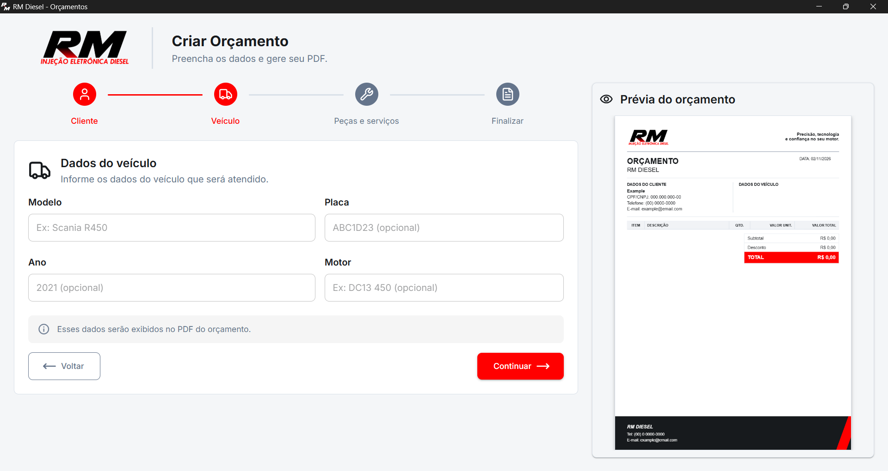

# RM Diesel - Orçamentos

Aplicativo desktop para criar orçamentos em PDF para uma oficina de injeção eletrônica diesel. O usuário preenche os dados em 4 etapas, acompanha a prévia do PDF em tempo real e salva o arquivo final.

> Projeto real, desenvolvido para uso de uma empresa.

## Prévia



## Funcionalidades

- Formulário em 4 etapas: Cliente, Veículo, Peças e serviços e Finalizar
- Validação dos campos com Zod e React Hook Form
- Máscaras de CPF/CNPJ, telefone, placa e ano
- Itens divididos em **Testes** e **Peças e serviços**, com quantidade, valor unitário e total calculado
- Adição e remoção de itens
- Desconto opcional, limitado ao subtotal
- Prévia do PDF ao vivo ao lado do formulário
- Salvamento do PDF pelo diálogo "Salvar como", com o nome sugerido `orcamento-nome-do-cliente.pdf`
- Instalador para Windows

## Tecnologias

- Electron e electron-vite
- React e TypeScript
- Material UI
- React Hook Form e Zod
- Zustand
- @react-pdf/renderer (geração do PDF)
- pdfjs-dist (prévia do PDF em canvas)

## Estrutura

```
src/
  main/       processo principal do Electron (janela e salvamento do PDF)
  preload/    ponte entre o app e o Electron
  renderer/
    src/
      components/   etapas do formulário, prévia e BudgetPdf
      schemas/      validações Zod
      store/        estado global (Zustand)
      utils/        máscaras e cálculo de totais
      assets/       logo
build/        ícones do instalador
resources/    ícone da janela
docs/         print para o README
```

## Decisões do projeto

- **Subtotal e total não são guardados no estado.** São calculados a partir dos itens e do desconto por uma função única, usada na tela, na prévia e no PDF, para os números nunca divergirem.
- **A prévia usa o mesmo componente do PDF salvo**, então o que aparece na tela é o que será gerado.
- **A prévia é desenhada em canvas** com pdfjs-dist, porque o visualizador de PDF embutido do Chromium não funcionou dentro do Electron.
- **O PDF é salvo pelo processo principal**, via IPC, para abrir o diálogo nativo de "Salvar como".

## Aviso sobre marca

A logo e os textos de marca pertencem à RM Diesel e estão neste repositório apenas para demonstração do projeto.
